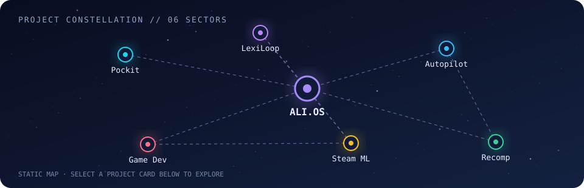
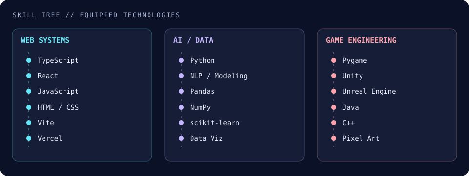
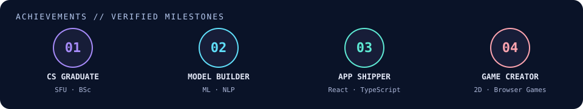
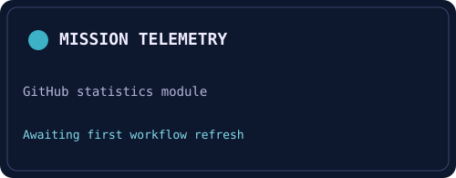
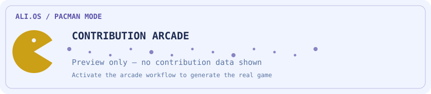
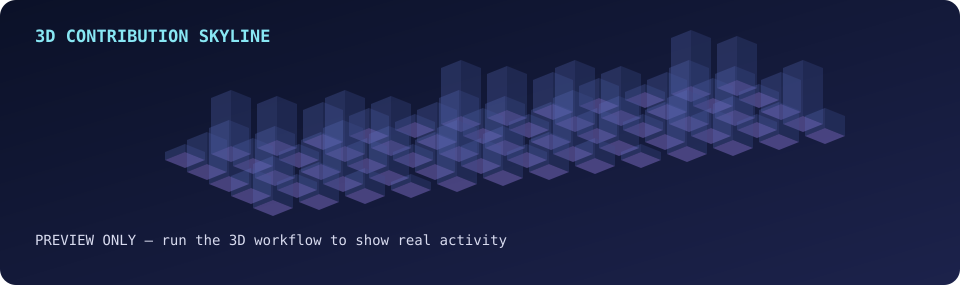

<!-- ALI.OS · Self-hosted profile assets. README motion uses SVG, not embedded JS. -->
<div align="center">



### Software developer · AI builder · game enthusiast

**Building useful apps, intelligent tools, and playful digital experiences.**

[**Explore my projects**](#-featured-builds) · [**Developer RPG**](#-developer-rpg) · [**The arcade**](#-the-arcade) · [**Contact**](#-communications)

[](https://www.linkedin.com/in/alinikan79/)
[](mailto:ali.nikan79@gmail.com)
[](https://github.com/alinikan?tab=repositories)

</div>

---

## 🛰️ Mission briefing

I'm **Ali Nikan**, a software developer with a **BSc in Computer Science from Simon Fraser University** and multiple Dean's Honour Roll distinctions. I love building things at the intersection of creativity and logic: practical web apps, data-driven tools, and games with personality.

I work with **React, TypeScript, Python, machine learning, and game development**. My favourite side quests include sci-fi, story-driven games, and experimenting with new ways to turn an idea into a working product.

> **CURRENT MISSION:** Building useful, thoughtful applications and improving the craft of software engineering.  
> **PLAYER TRAIT:** Always curious. Sometimes distracted by a cool game idea. 🎮

<details>
<summary><b>📡 Open the developer dossier</b></summary>

- 🎓 **Education:** Computer Science, Simon Fraser University; Dean's Honour Roll.
- 🧠 **Interests:** AI, machine learning, modern web development, game development.
- 🧩 **I enjoy:** Data analysis, C/C++, Python, UI engineering, and creative problem-solving.
- 🎬 **Off duty:** Story-driven games and sci-fi, especially *The Last of Us* and *Interstellar*.
- 💬 **Ask me about:** Projects, software architecture, game ideas, or recommendations for a good story-driven game.

</details>

## 🌌 Project constellation

<div align="center">



*Six project systems, one developer universe. Explore the projects below to open each sector.*

</div>

## 🚀 Featured builds

### 🌐 Modern applications

<table>
<tr>
<td width="50%" valign="top">
<h3>💸 Pockit</h3>
<p><b>Personal finance · TypeScript</b></p>
<p>A budgeting and planning companion with spending, recurring bills, savings goals, debt planning, and account tracking.</p>
<p><a href="https://github.com/alinikan/pockit">Source</a> · <a href="https://pockit-budget.vercel.app">Live app</a></p>
</td>
<td width="50%" valign="top">
<h3>🧠 LexiLoop</h3>
<p><b>Vocabulary learning · AI · TypeScript</b></p>
<p>A vocabulary practice app with spaced review, personal wordbooks, and AI-assisted lesson generation.</p>
<p><a href="https://github.com/alinikan/LexiLoop">Source</a> · <a href="https://lexiloop-ali.vercel.app">App</a> (may require sign-in)</p>
</td>
</tr>
<tr>
<td width="50%" valign="top">
<h3>🚗 Autopilot</h3>
<p><b>Car-learning · React · Supabase</b></p>
<p>Visual lessons, photo recognition, quizzes, and gamified review, designed around vehicles and data relevant to Canada.</p>
<p><a href="https://github.com/alinikan/autopilot-car-school">Source</a> · <a href="https://autopilot-car-school.vercel.app">Live app</a></p>
</td>
<td width="50%" valign="top">
<h3>🏋️ Recomp</h3>
<p><b>Fitness · TypeScript · Supabase</b></p>
<p>A mobile-first training and nutrition companion with workouts, progress tracking, and optional cloud sync.</p>
<p><a href="https://github.com/alinikan/workout-tracker">Source</a> · <a href="https://ali-workout.vercel.app">Live app</a></p>
</td>
</tr>
</table>

### 🤖 AI & machine learning

<table>
<tr>
<td width="50%" valign="top">
<h3>🎯 Steam Game Recommender</h3>
<p>Content-based and NLP-powered game recommendations, alongside popularity prediction with machine learning.</p>
<a href="https://github.com/alinikan/GameRecommender">Explore source →</a>
</td>
<td width="50%" valign="top">
<h3>🐈 Cat Identifier</h3>
<p>A cat-versus-non-cat image classifier built around a deep neural network and fundamentals of forward/backward propagation.</p>
<a href="https://github.com/alinikan/Cat-Identifier">Explore source →</a>
</td>
</tr>
</table>

### 🕹️ Games & creative experiments

<table>
<tr>
<td width="50%" valign="top">
<h3>🌙 After the Last Bell</h3>
<p>An original pixel-art, browser-based narrative game with animated characters, choices, and music.</p>
<a href="https://github.com/alinikan/after-the-last-bell-game">Source</a> · <a href="https://after-the-last-bell-game.vercel.app">Play</a>
</td>
<td width="50%" valign="top">
<h3>🧭 Maze Runner</h3>
<p>A Java maze game with enemies, levels, an MVC architecture, and tests.</p>
<a href="https://github.com/alinikan/MazeRunner">Explore source →</a>
</td>
</tr>
<tr>
<td width="50%" valign="top">
<h3>👾 Dynamic Obstacle Runner</h3>
<p>A Pygame platformer with dynamic obstacles, animation, and collision mechanics.</p>
<a href="https://github.com/alinikan/My-First-2D-Game">Explore source →</a>
</td>
<td width="50%" valign="top">
<h3>✨ More side quests</h3>
<p>Explore my other experiments: Star Wars tools, RPG projects, utilities, data analysis, and more.</p>
<a href="https://github.com/alinikan?tab=repositories">Open the entire repository archive →</a>
</td>
</tr>
</table>

<details>
<summary><b>🎞️ Project gallery — actual application imagery</b></summary>

**Pockit**


**Autopilot**


**Recomp**


</details>

---

## 🧙 Developer RPG

**PLAYER:** Ali Nikan · **CLASS:** Creative Software Builder · **SPECIALIZATION:** Web / AI / Games

No invented proficiency percentages: this is an inventory of technologies used or explored, not a claim of measured expertise.

<div align="center">



### 🏆 Unlocked achievements



</div>

<details>
<summary><b>📜 Character progression / developer timeline</b></summary>

- **Early chapters:** Learned computer science fundamentals, programming, and problem solving at SFU.
- **Data & AI arc:** Built classifiers, data-analysis projects and a Steam game recommendation system.
- **Game-dev arc:** Experimented with Java games, Pygame, pixel art and interactive storytelling.
- **2026 — the app-building arc:** Shipped React/TypeScript projects including LexiLoop, Pockit, Recomp and Autopilot.
- **Next level:** Continue refining applications, exploring ML, and creating interesting experiences.

</details>

---

## 📡 Mission telemetry

*Self-hosted cards, generated through GitHub Actions and committed to this repository — not fetched on every view from a fragile public stats server.*

<div align="center">


</div>

<details>
<summary><b>⚙️ Telemetry maintenance and refresh</b></summary>

This section uses the maintained [GitHub Readme Stats Action](https://github.com/stats-organization/github-readme-stats-action). The static fallback cards show until the [telemetry workflow](./.github/workflows/telemetry.yml) succeeds. GitHub Actions refreshes the saved SVGs on schedule, and workflow dispatch allows a manual run. The data only covers what the token permits. GitHub language data is based on repository code, not an assessment of programming ability.

[Open the repository's Actions tab](https://github.com/alinikan/alinikan/actions)

</details>

<details>
<summary><b>🛰️ Activity intel / current signals</b></summary>

- [My native GitHub contribution calendar](https://github.com/alinikan#user-activity-overview)
- [Recent repository updates](https://github.com/alinikan?tab=repositories)
- [Public developer activity](https://github.com/alinikan?tab=overview)

**What's new:** Check the [Autopilot](https://github.com/alinikan/autopilot-car-school), [Recomp](https://github.com/alinikan/workout-tracker), [Pockit](https://github.com/alinikan/pockit), and [LexiLoop](https://github.com/alinikan/LexiLoop) repositories for ongoing releases. Project priority is editorial, not automatically inferred from commit dates.

</details>

---

## 👾 The arcade

**Pac-Man is the main contribution game.** It is shown below using dark/light theme-aware SVGs. This draft includes clearly labelled preview art; the [arcade workflow](./.github/workflows/arcade.yml) replaces it with **actual contribution-based animation** after its first successful run. The other seven games have their own expandable launch links, including the main Pac-Man mode for quick access.

<div align="center">

<picture>
  <source media="(prefers-color-scheme: dark)" srcset="./generated/arcade/pacman-contribution-graph-dark.svg">
  <source media="(prefers-color-scheme: light)" srcset="./generated/arcade/pacman-contribution-graph.svg">
  
</picture>

</div>

<details>
<summary><b>🎮 Choose from all eight arcade modes</b></summary>

| Mode | Preview / generated graph |
|---|---|
| 👻 **Pac-Man** — main mode | [Launch Pac-Man](./generated/arcade/pacman-contribution-graph-dark.svg) |
| 🚀 Galaga | [Launch Galaga](./generated/arcade/galaga-contribution-graph-dark.svg) |
| 🧱 Breakout | [Launch Breakout](./generated/arcade/breakout-contribution-graph-dark.svg) |
| 🐍 Snake | [Launch Snake](./generated/arcade/snake-contribution-graph-dark.svg) |
| 🟪 Tetris | [Launch Tetris](./generated/arcade/tetris-contribution-graph-dark.svg) |
| 💣 Bomberman | [Launch Bomberman](./generated/arcade/bomberman-contribution-graph-dark.svg) |
| 💠 Minesweeper | [Launch Minesweeper](./generated/arcade/minesweeper-contribution-graph-dark.svg) |
| 🫧 Puzzle Bobble | [Launch Puzzle Bobble](./generated/arcade/puzzle-bobble-contribution-graph-dark.svg) |

These currently display branded **activation previews**, not fictional GitHub contribution data. When the workflow runs, it replaces the assets with real contribution visualizations.

</details>

<details>
<summary><b>🧊 3D contributions — an alternative camera angle</b></summary>



The [3D contribution workflow](./.github/workflows/profile-3d.yml) generates a genuine isometric skyline. Until its first successful run, the image is explicitly labelled a preview.

</details>

---

## 🗝️ Classified: Area 79

<details>
<summary><b>🔒 ACCESS RESTRICTED — click to decrypt a transmission</b></summary>

**INCOMING SIGNAL / SECTOR 79**

```text
SYSTEM:  A locked star chart is waiting...
CLUE:    I have cities, but no houses;
         forests, but no trees;
         rivers, but no water.
QUESTION: What am I?
```

<details><summary>🗝️ Reveal the access code</summary>

**A map.** Access granted, explorer. 🌌

*Achievement unlocked: YOU READ THE FINE PRINT.*

</details>

</details>

### 🎮 A tiny browser side quest

[Play **After the Last Bell**](https://after-the-last-bell-game.vercel.app) — an actual story-based game I built. I've also built an original **Starfall** mini-game in the [ALI.OS companion portal source](./site/README.md). It runs in a browser once the companion site is deployed; GitHub profile READMEs don't execute arbitrary JavaScript.

---

## 🔭 Experimental modules and bonus features

The README stays fast and readable. Advanced interactions live in a **separate, fully coded companion portal** in [`site/`](./site/README.md); it isn't publicly deployed yet.

<details>
<summary><b>🤖 AI project concierge / ask the archive</b></summary>

The companion portal includes a working **local project guide** that searches curated public repositories without sending visitor questions to a server. It also includes a server-side OpenAI adapter in [`site/api/ask.js`](./site/api/ask.js), currently disabled until a deployment, API key, spending limits and abuse protection are configured. It must never expose API keys in browser code.

</details>

<details>
<summary><b>📆 Auto-rotating seasonal systems</b></summary>

The [theme workflow](./.github/workflows/seasonal.yml) is configured to rotate the README banner by month: **Galactic Winter** (December–February), **Arcade Event** (October), and **Nebula** (the remaining months). It can also be manually set to any of the three. The companion portal has its own instant, visitor-controlled theme switch.

[See Nebula](./assets/themes/hero-nebula.svg) · [See Winter](./assets/themes/hero-winter.svg) · [See Arcade](./assets/themes/hero-arcade.svg)

</details>

<details>
<summary><b>🎧 Now Playing / soundtrack station</b></summary>

The optional [Last.fm workflow](./.github/workflows/now-playing.yml) and [public display JSON](./site/now-playing.json) are ready. **No listening account is connected**, and no personal listening activity is published by default. With an opt-in Last.fm username and API key stored as a repository secret, the companion portal can display a real recent track (and distinguish current playback from older activity).

</details>

<details>
<summary><b>📬 Visitor guestbook / transmissions</b></summary>

A [moderated GitHub Issue form](./.github/ISSUE_TEMPLATE/guestbook.yml) and approved-entry reader are prepared. Visitors may submit public messages via GitHub after the PR merges; messages only display in the companion portal after the owner adds `guestbook-approved`. Nothing is automatically approved.

</details>

<details>
<summary><b>🕹️ Bonus: interactive galaxy and Starfall</b></summary>

The [companion portal](./site/README.md) includes a clickable repository constellation, searchable project cards, theme switcher, a keyboard/touch-friendly **Starfall** mini-game, a local project Q&A guide, and a guestbook viewer. These features require a normal website, not an embedded README.

</details>

---

## 📡 Communications

Want to talk software engineering, machine learning, web apps, or story-driven games?

[](https://www.linkedin.com/in/alinikan79/)
[](mailto:ali.nikan79@gmail.com)

<div align="center">

`ALI.OS // END OF TRANSMISSION`  
**Thanks for exploring my developer universe.** 🚀

</div>
